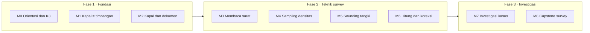

# Draught Survey: Kerangka Materi & Learning Path VR

Versi 23 Oktober 2026 · Sumber: [Claude Doc](https://claude.ai/artifact/HoVpZLQ2pBdg6VgvTznFM3)

> **Kerahasiaan:** Bagian B memuat modus operandi manipulasi berat muatan. Dokumen ini hanya untuk penggunaan internal.

## Pengantar

Peserta harus mampu menghitung draught survey sendiri dan menemukan di titik mana angka muatan bisa dikecilkan. Dua kemampuan ini adalah inti pengawasan kuantitas muatan curah.

- **Sasaran peserta:** pemeriksa barang, pemeriksa dokumen, dan analis intelijen/P2 yang mengawasi ekspor dan impor curah kering (batubara, mineral, klinker, gandum, gula, garam, pupuk).
- **Sudut pandang:** setiap modus dibahas dari sisi deteksi. Untuk tiap modus, peserta belajar indikator, cara uji, dan dokumen pembanding.
- **Rujukan teknis:** prosedur mengikuti praktik umum surveyor dan *UN/ECE Code of Uniform Standards and Procedures for the Performance of Draught Surveys of Coal Cargoes* (1992). Ketentuan kepabeanan yang berlaku perlu diverifikasi ke direktorat teknis sebelum materi final (lihat Lampiran).
- **Cara membaca:** Bagian A = isi teknis. Bagian B = titik rawan dan modus. Bagian C = alur modul VR. Lampiran = contoh hitung lengkap dan uji sensitivitas, yang bisa langsung dipakai sebagai data skenario.

## Bagian A — Tahapan, variabel, dan rumus

Berat muatan = berat bersih kapal saat final dikurangi berat bersih saat initial (muat), atau kebalikannya (bongkar). Seluruh tahap di bawah dikerjakan dua kali dengan urutan yang sama.

```latex
\text{Muatan (muat)} = \text{Net Displacement}_{final} - \text{Net Displacement}_{initial}
```

### A1. Persiapan dan dokumen kapal

Surveyor memastikan semua tabel yang dipakai milik kapal itu sendiri, bukan kapal sister.

| Dokumen / data | Isi yang dipakai | Kegunaan |
| --- | --- | --- |
| Ship's particulars | LBP, lightship, deadweight | Dasar koreksi dan uji constant |
| Hydrostatic table | Displacement, TPC, LCF, MTC per sarat | Mengubah sarat menjadi berat |
| Draft mark positions | Jarak tanda sarat ke FP, AP, midship | Koreksi perpendikular |
| Tank calibration table | Volume per sounding/ullage, koreksi trim | Menghitung ballast, BBM, air tawar |
| Riwayat survey dan constant | Constant pada pelayaran sebelumnya | Uji kewajaran |
| Sertifikat hydrometer | Kalibrasi alat ukur densitas | Validitas densitas |

### A2. Pembacaan sarat 6 titik

Sarat dibaca di haluan, tengah, dan buritan, sisi kiri (P) dan kanan (S). Sisi laut dibaca dari perahu, bukan diperkirakan.

- Variabel: F_P, F_S, M_P, M_S, A_P, A_S (meter).
- Saat ada ombak, catat beberapa puncak dan lembah lalu ambil rata-ratanya.
- Kondisi dicatat: waktu, cuaca, arus, kegiatan pompa, status crane.

```latex
F_m = \frac{F_P + F_S}{2},\quad M_m = \frac{M_P + M_S}{2},\quad A_m = \frac{A_P + A_S}{2},\quad T_{app} = A_m - F_m
```

### A3. Koreksi perpendikular (draft mark correction)

Tanda sarat jarang tepat di garis tegak haluan (FP), buritan (AP), atau tengah kapal. Pembacaan dipindahkan ke garis tegak tersebut.

```latex
LBM = LBP - d_F - d_A
```

```latex
\Delta F = \frac{T_{app} \times d_F}{LBM},\quad \Delta A = \frac{T_{app} \times d_A}{LBM},\quad \Delta M = \frac{T_{app} \times d_M}{LBM}
```

- d_F, d_A, d_M = jarak tanda sarat ke FP, AP, dan midship (meter).
- Tanda koreksi bergantung pada posisi tanda sarat dan arah trim. Contoh: trim buritan dan tanda haluan berada di belakang FP → ΔF dikurangi.
- Hasilnya F, A, M terkoreksi dan trim sejati T = A − F.

### A4. Mean of means dan quarter mean (koreksi hogging/sagging)

Lambung kapal bisa melengkung. Quarter mean memberi bobot besar pada sarat tengah.

```latex
QM = \frac{F + A + 6M}{8}
```

Jika M lebih dalam dari rata-rata F dan A, kapal sagging. Jika lebih dangkal, kapal hogging.

### A5. Displacement dari tabel hidrostatik

Dengan QM, baca dari tabel (interpolasi linear): displacement, TPC (ton per cm), LCF (titik berat bidang air dari midship), dan MTC (momen pengubah trim 1 cm). Nilai tabel umumnya untuk densitas 1,025 t/m³.

### A6. Koreksi trim pertama dan kedua

Tabel hidrostatik disusun untuk kapal *even keel*. Kapal yang trim perlu dua koreksi.

```latex
FTC = \frac{T \times LCF \times TPC \times 100}{LBP}
```

- FTC bertanda positif jika LCF dan ujung yang lebih dalam berada di sisi yang sama dari midship. Contoh: LCF di belakang midship dan trim buritan → ditambah.

```latex
STC = \frac{50 \times T^2 \times (MTC_{+0,5} - MTC_{-0,5})}{LBP}
```

- MTC₊₀,₅ dan MTC₋₀,₅ = MTC pada QM + 0,5 m dan QM − 0,5 m. STC selalu ditambah.

### A7. Koreksi list (kemiringan)

```latex
LC = 6 \times (M_P - M_S)^2 \times (TPC_P - TPC_S)
```

Koreksi ini selalu positif dan biasanya kecil. Bila diabaikan, alasannya harus tercatat.

### A8. Koreksi densitas

Air di lokasi kapal disampling pada beberapa kedalaman dan posisi di sekitar lambung, lalu diukur dengan hydrometer.

```latex
Disp_{terkoreksi} = Disp_{tabel+koreksi} \times \frac{\rho_{terukur}}{1{,}025}
```

- Pastikan jenis hydrometer (densitas di udara atau di vakum) sesuai dengan dasar tabel kapal.
- Selisih densitas 0,001 pada kapal 40.000 ton setara sekitar 40 ton muatan.

### A9. Deductibles (isi rumah tangga kapal)

Semua berat non-muatan disounding dan dihitung beratnya, lalu dikurangkan.

| Komponen | Cara ukur | Variabel kunci |
| --- | --- | --- |
| Air ballast | Sounding/ullage setiap tangki | Volume tabel, koreksi trim/list, densitas air ballast |
| Air tawar | Sounding | Volume, densitas ±1,000 |
| Bahan bakar (HFO, MDO) | Sounding + suhu | Volume, densitas pada 15 °C, koreksi suhu |
| Minyak pelumas | Sounding | Volume, densitas |
| Bilge, sludge, lainnya | Sounding | Volume, densitas |

```latex
Net\ Displacement = Disp_{terkoreksi} - \sum Deductibles
```

### A10. Lightship dan constant

Constant adalah berat tak teridentifikasi di kapal (stores, lumpur, sisa muatan, cat). Nilainya dihitung saat initial survey kapal kosong.

```latex
Constant = Net\ Displacement_{initial} - Lightship
```

Constant yang jauh berbeda dari riwayat pelayaran sebelumnya, atau bernilai negatif, adalah tanda bahaya.

### A11. Final survey dan pelaporan

Tahap A2–A9 diulang setelah muat atau bongkar selesai, palka ditutup, dan pompa berhenti. Laporan memuat seluruh pembacaan mentah, bukan hanya hasil akhir. Ketelitian metode ini umumnya sekitar ±0,5% (contoh perhitungan lengkap ada di Lampiran).

## Bagian B — Titik kritis, titik rawan, dan modus operandi

Setiap manipulasi berat bekerja dengan dua cara: mengecilkan berat bersih pada survey yang "berisi muatan", atau membesarkan berat bersih pada survey yang "kosong". Pemeriksa yang paham arah ini tahu angka mana yang harus diuji lebih dulu.

### B1. Arah manipulasi

| Kegiatan | Tujuan pelaku | Survey berisi muatan | Survey kosong |
| --- | --- | --- | --- |
| Ekspor (muat) — menekan bea keluar/pungutan | Muatan tampak lebih kecil | Final: sarat dibaca lebih dangkal, densitas dilaporkan lebih rendah, deductibles dibesarkan | Initial: sarat dibaca lebih dalam, ballast/BBM disembunyikan, constant dibesarkan |
| Impor (bongkar) — menekan bea masuk dan PDRI | Muatan tampak lebih kecil | Initial: sarat dibaca lebih dangkal, densitas lebih rendah, deductibles dibesarkan | Final: sarat lebih dalam, ballast tersembunyi, sisa muatan di palka tidak diakui |

Ketentuan pungutan per komoditas (bea keluar, larangan/pembatasan ekspor mineral, PDRI) perlu dicek ke regulasi terbaru. Arah manipulasi tetap sama apa pun tarifnya.

### B2. Titik kritis dan modus

| Titik kritis | Modus yang sering ditemui | Efek pada angka muatan | Indikator / red flag | Uji oleh pemeriksa |
| --- | --- | --- | --- | --- |
| Pembacaan sarat | Membaca saat ombak tanpa rata-rata; sisi laut "diperkirakan"; angka dari master tanpa dibaca sendiri; tanda sarat dicat ulang atau tidak standar | 1 cm ≈ 1 TPC (±50 t pada kapal Supramax/Panamax) | Sisi P dan S identik sempurna; tidak ada catatan kondisi laut; foto tanda sarat tidak ada | Baca sendiri 6 titik dari perahu; foto/video tiap tanda; bandingkan selisih P–S dengan list yang terlihat |
| Koreksi perpendikular dan trim | Tanda koreksi dibalik; d_F/d_A dari kapal lain; LCF dibaca dari kolom salah | Puluhan ton per kesalahan tanda | Trim sejati tidak konsisten dengan trim tampak; FTC bernilai negatif padahal LCF dan trim searah | Hitung ulang dari data mentah; cek posisi tanda sarat pada gambar kapal |
| Tabel hidrostatik | Memakai tabel kapal sister; halaman diganti; interpolasi salah | Ratusan ton | Nama kapal/galangan tidak sesuai; tabel fotokopi tanpa pengesahan | Minta tabel asli di kapal; cocokkan IMO number dan galangan |
| Densitas air | Sampel di permukaan dekat buangan air tawar/sungai; satu titik saja; hydrometer tidak terkalibrasi | 0,001 ≈ 40 t pada kapal 40.000 t | Densitas jauh berbeda dari survey lain di lokasi sama; tidak ada sertifikat hydrometer | Sampling sendiri di beberapa kedalaman dan posisi lambung; bawa hydrometer sendiri |
| Air ballast | Tangki tidak disounding; pipa sounding tersumbat; pompa ballast jalan saat survey; tangki "kosong" ternyata berisi; tabel kalibrasi tertukar | Langsung 1:1 dengan berat muatan | Volume ballast berubah antara jam survey dan jam laporan; log pompa tidak konsisten | Sounding sendiri seluruh tangki termasuk fore peak dan double bottom; segel valve pompa; minta ballast log |
| BBM dan air tawar | Angka dari chief engineer tanpa sounding; bunkering di antara initial–final tidak dicatat | 1:1 | Konsumsi harian tidak masuk akal; ada tongkang bunker tercatat di pelabuhan | Sounding sendiri; cocokkan dengan bunker delivery note dan log mesin |
| Constant | Constant dibesarkan pada initial; ruang kosong (void, cofferdam, duct keel) berisi air atau muatan | 1:1 | Constant beda jauh dari riwayat; constant negatif | Bandingkan dengan 3–5 survey terakhir; periksa void space |
| Waktu dan lokasi | Muat lanjut setelah final survey; tambahan muatan dari tongkang di lego jangkar; muatan sisa di palka tidak diakui | Ratusan sampai ribuan ton | Kapal tidak langsung berangkat; ada tongkang di samping kapal setelah survey; AIS menunjukkan berhenti | Saksikan sampai palka ditutup; data AIS; pengawasan patroli |
| Laporan surveyor | Laporan tanpa kehadiran fisik; hanya hasil akhir tanpa data mentah; revisi laporan tanpa alasan | Seluruh angka bisa tidak valid | Jam survey bertabrakan dengan jadwal lain; tanda tangan master tanpa saksi | Minta lembar kerja asli; wawancara surveyor; cek konsistensi jam |
| Dokumen pembanding | Angka B/L, mate's receipt, dan pemberitahuan pabean disamakan dengan survey yang sudah dimanipulasi | — | Semua dokumen identik sampai desimal | Bandingkan dengan stockpile survey, belt scale, tally tongkang, invoice, dan kontrak |

### B3. Konteks khas Indonesia

- **Tongkang dan transshipment.** Ekspor batubara dan mineral banyak dimuat dari tongkang di area lego jangkar. Survey tongkang dan mother vessel sering terpisah, sehingga penjumlahan muatan per tongkang harus cocok dengan survey kapal.
- **Kadar air (bijih mineral, batubara).** Berat dari draught survey adalah berat basah. Jika pungutan berdasarkan berat kering, angka kadar air menjadi titik rawan tersendiri di luar draught survey.
- **Banyak pelabuhan muat.** Muatan parsial di beberapa pelabuhan membuka peluang selisih antar-survey.

### B4. Prinsip kerja pemeriksa

1. Ambil data mentah sendiri: sarat, densitas, dan sounding. Jangan hanya menerima hasil akhir.
2. Hitung ulang secara independen dengan tabel asli kapal.
3. Uji sensitivitas: selisih yang wajar adalah sekitar 0,5%. Selisih yang lebih besar perlu dijelaskan oleh dokumen.
4. Dokumentasikan dengan foto, video, dan berita acara yang ditandatangani para pihak.
5. Silang-cek dengan data di luar kapal: dokumen pemberitahuan, invoice, stockpile, AIS, dan riwayat kapal.

## Bagian C — Learning path modul VR

Alur belajar terdiri dari 9 modul dalam 3 fase: memahami konsep, menguasai teknik survey, lalu menginvestigasi kasus manipulasi. Fase investigasi memakai data yang sama dengan fase teknik, sehingga peserta menemukan sendiri kejanggalan dalam angka yang sudah mereka kuasai.



Fase 1 dan 2 bisa diulang di desktop atau ponsel; Fase 3 sebaiknya dijalankan penuh di headset VR.

### C1. Rincian modul

| Modul | Tujuan belajar | Lingkungan VR | Interaksi utama | Asesmen |
| --- | --- | --- | --- | --- |
| M0 Orientasi dan K3 | Menggunakan kontrol VR; menerapkan keselamatan naik kapal | Dermaga, gangway, pilot ladder | Memakai APD, naik tangga pandu, mengenali area confined space | Checklist K3 lulus 100% |
| M1 Kapal = timbangan | Menjelaskan hukum Archimedes dan konsep displacement | Kolam simulasi dengan kapal mini | Menambah muatan lalu mengamati garis air; mengubah densitas air | Kuis prediksi: kapal naik atau turun |
| M2 Kapal dan dokumen | Menemukan tanda sarat, tangki, pipa sounding; membaca tabel hidrostatik | Walkthrough kapal bulk carrier + ruang mualim | Menandai 6 tanda sarat; mencocokkan IMO number pada tabel | Temukan 6 tanda + 5 dokumen dalam batas waktu |
| M3 Membaca sarat | Membaca sarat 6 titik dengan akurasi ±1 cm | Perahu kecil di sisi lambung, ombak dapat diatur | Membaca saat ombak dengan metode puncak-lembah | Selisih dengan nilai sebenarnya ≤1 cm |
| M4 Sampling densitas | Mengambil sampel representatif dan membaca hydrometer | Sisi lambung dan dek | Menurunkan sampler di beberapa kedalaman; membaca hydrometer | Densitas akurat ±0,0005 |
| M5 Sounding tangki | Menyounding ballast, BBM, air tawar dan menghitung beratnya | Dek, ruang mesin, tangki | Sounding tape, termometer, membaca tabel kalibrasi | Total deductibles ±0,5% |
| M6 Hitung dan koreksi | Menghitung koreksi perpendikular, trim, list, densitas sampai berat muatan | Tablet virtual di ruang mualim | Lembar kerja interaktif; umpan balik per langkah | Hasil akhir dalam toleransi ±0,5% |
| M7 Investigasi kasus | Mengenali red flag dan modus pada Bagian B | Kapal yang sama dengan anomali tertanam | Memeriksa, memotret, bertanya ke kru (NPC), membandingkan dokumen | Menemukan minimal 5 dari 7 anomali |
| M8 Capstone survey | Melakukan initial–final survey lengkap dan menyusun rekomendasi | Skenario muat batubara dari tongkang di lego jangkar | Survey penuh, wawancara, keputusan, berita acara | Rubrik: akurasi, temuan, dokumentasi, keputusan |

### C2. Prinsip desain imersif

- **Satu kapal, banyak kondisi.** Gunakan satu model kapal yang sama di seluruh modul. Ubah kondisinya: kosong, bermuatan, trim, list, ombak, malam hari.
- **Data skenario dari mesin hitung yang sama.** Nilai sarat, tangki, dan densitas dihasilkan dari satu model perhitungan (lihat contoh di Lampiran). Dengan cara ini manipulasi yang ditanam di M7 konsisten secara matematis.
- **Anomali bertingkat.** Level 1 kasat mata (pompa ballast menyala). Level 2 butuh hitung ulang (tanda koreksi trim dibalik). Level 3 butuh silang-dokumen (constant tidak cocok riwayat).
- **NPC dengan agenda.** Mualim, chief engineer, dan surveyor bisa kooperatif, mengulur waktu, atau memberi angka tanpa pengukuran. Peserta berlatih bersikap dan mengambil keputusan.
- **Bukti tercatat.** Setiap foto, sounding, dan pembacaan masuk ke "buku saku digital" yang menjadi dasar berita acara di M8.

### C3. Strategi multi-device

VR menjadi pengalaman utama, tetapi tidak semua peserta punya headset. Bangun dengan WebXR atau engine yang bisa diekspor ke beberapa mode:

- **Headset VR:** pengalaman penuh untuk M0, M3–M5, M7–M8.
- **Desktop/tablet:** mode 3D dengan klik dan drag; M1, M2, dan M6 tetap efektif.
- **Ponsel:** panorama 360° dan lembar kerja; cocok untuk latihan ulang M6 dan kuis.

Data progres disimpan di LMS (misalnya lewat xAPI) supaya hasil lintas perangkat tercatat dalam satu profil peserta.

## Lampiran

### L1. Contoh perhitungan final survey (muat batubara)

Hasil contoh: muatan 31.573,30 ton. Semua angka kapal di bawah adalah data fiktif untuk latihan dan skenario VR.

**Data kapal:** LBP 180,0 m. Tanda haluan 3,0 m di belakang FP (d_F). Tanda buritan 6,0 m di depan AP (d_A). Tanda tengah 0,5 m di belakang midship (d_M). LBM = 180,0 − 3,0 − 6,0 = 171,0 m.

| Langkah | Perhitungan | Hasil |
| --- | --- | --- |
| 1. Sarat terbaca | F 10,10 / 10,14 · M 10,31 / 10,35 · A 10,58 / 10,62 (P / S) | F_m 10,120 · M_m 10,330 · A_m 10,600 m |
| 2. Trim tampak | 10,600 − 10,120 | 0,480 m (buritan) |
| 3. Koreksi perpendikular | ΔF = −0,48 × 3,0 / 171 · ΔA = +0,48 × 6,0 / 171 · ΔM = −0,48 × 0,5 / 171 | F 10,112 · A 10,617 · M 10,329 m |
| 4. Trim sejati | 10,617 − 10,112 | 0,505 m |
| 5. Hog/sag | (F + A) / 2 = 10,3645 vs M 10,329 | Hogging 3,6 cm |
| 6. Quarter mean | (10,112 + 10,617 + 6 × 10,329) / 8 | 10,338 m |
| 7. Tabel hidrostatik | Interpolasi 10,30 m (41.200 t; TPC 52,0; LCF −2,80) dan 10,40 m (41.720 t; TPC 52,1; LCF −2,90) | Disp 41.397,60 t · TPC 52,038 · LCF 2,838 m di belakang midship |
| 8. FTC | 0,505 × 2,838 × 52,038 × 100 / 180 (LCF belakang + trim buritan → ditambah) | +41,43 t |
| 9. STC | 50 × 0,505² × (541,0 − 503,0) / 180 | +2,69 t |
| 10. List | Selisih P–S tengah 0,04 m → 6 × 0,04² × ±0,1 | ≈ 0 t (dicatat) |
| 11. Disp terkoreksi trim | 41.397,60 + 41,43 + 2,69 | 41.441,72 t |
| 12. Koreksi densitas | 41.441,72 × 1,018 / 1,025 | 41.158,70 t |
| 13. Deductibles | Ballast 350 · air tawar 180 · HFO 820 · MDO 95 · pelumas 25 · lainnya 10 | 1.480,00 t |
| 14. Net displacement final | 41.158,70 − 1.480,00 | 39.678,70 t |
| 15. Net displacement initial | Dari initial survey (lightship 7.850 t + constant 255,40 t) | 8.105,40 t |
| 16. Berat muatan | 39.678,70 − 8.105,40 | **31.573,30 t** |

### L2. Uji sensitivitas: manipulasi kecil yang menumpuk

Setiap manipulasi di bawah terlihat kecil dan masih di dalam toleransi 0,5% (±158 t). Bila digabung, totalnya bisa mencapai sekitar 360 ton (1,1%). Inilah alasan pemeriksa harus menguji setiap komponen, bukan hanya angka akhir.

| Manipulasi pada final survey | Dampak terhadap muatan (t) | % dari muatan |
| --- | --- | --- |
| Sarat dibaca 1 cm lebih dangkal | −51,7 | 0,16% |
| Densitas dilaporkan 0,002 lebih rendah | −80,9 | 0,26% |
| Tanda FTC dibalik | −82,3 | 0,26% |
| Ballast dilaporkan 100 t lebih banyak | −100,0 | 0,32% |
| Hydrometer "vakum" dipakai untuk tabel "udara" (selisih 0,0011) | −44,5 | 0,14% |
| **Gabungan** | **−359,4** | **1,14%** |

Tabel ini bisa langsung menjadi data skenario M7: tanam dua sampai tiga manipulasi sekaligus agar peserta belajar bahwa angka akhir yang "wajar" belum tentu benar.

### L3. Glosarium

| Istilah | Arti |
| --- | --- |
| Draught / sarat | Kedalaman lambung yang terbenam |
| FP / AP | Garis tegak haluan / buritan |
| LBP | Panjang kapal antara FP dan AP |
| Trim | Selisih sarat buritan dan haluan |
| List | Kemiringan ke kiri atau kanan |
| Hogging / sagging | Lambung melengkung ke atas / ke bawah di tengah |
| Displacement | Berat total kapal = berat air yang dipindahkan |
| TPC | Ton per cm: tambahan berat untuk menambah sarat 1 cm |
| LCF | Titik berat bidang air, diukur dari midship |
| MTC | Momen yang mengubah trim 1 cm |
| Deductibles | Berat non-muatan yang dikurangkan (ballast, BBM, air tawar) |
| Lightship | Berat kapal kosong sesuai dokumen galangan |
| Constant | Berat tak teridentifikasi di kapal kosong |
| Sounding / ullage | Kedalaman cairan / ruang kosong di atas cairan dalam tangki |

### L4. Hal yang perlu diverifikasi sebelum materi final

- [ ] Regulasi terbaru tentang bea keluar dan pungutan ekspor per komoditas curah
- [ ] Ketentuan larangan/pembatasan ekspor mineral yang berlaku
- [ ] Ketentuan Laporan Surveyor (LS) dan peran surveyor independen
- [ ] SOP internal pemeriksaan fisik muatan curah dan format berita acara
- [ ] Validasi rumus dan contoh hitung oleh surveyor bersertifikat atau widyaiswara teknis
