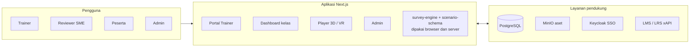

# PRD: Platform Simulasi Draught Survey

Versi 20 November 2026 · Sumber: [Claude Doc](https://claude.ai/artifact/YDTLKojasmvsekWbL4Puj3)

Platform web fullstack untuk melatih pegawai Bea Cukai melakukan dan menguji draught survey langsung dari peramban web di desktop dan ponsel, tanpa headset VR. Headset VR (WebXR) menjadi pengalaman tambahan yang lebih imersif, bukan syarat. Trainer dapat membuat skenario baru tanpa bantuan developer.

## 1. Ringkasan

**Masalah.** Pegawai jarang berkesempatan berlatih draught survey di kapal sungguhan. Akibatnya, mereka cenderung menerima hasil akhir laporan surveyor tanpa menguji komponennya. Selisih ratusan ton dapat lolos karena setiap manipulasi tampak masih dalam toleransi.

**Solusi.** Simulasi kapal 3D yang bisa dijalankan di peramban desktop dan ponsel, dan di headset VR bagi yang memilikinya. Peserta membaca sarat, mengambil sampel air, menyounding tangki, menghitung, dan menginvestigasi anomali. Trainer membuat dan memperbarui skenario lewat portal web.

**Tujuan produk**

1. Peserta mampu menghitung berat muatan dari data mentah dengan selisih ≤0,5% dari kunci jawaban.
2. Peserta mampu menemukan anomali tertanam dan menjelaskan dampaknya dalam ton.
3. Trainer dapat menerbitkan skenario baru dalam ≤1 hari kerja tanpa developer.

**Metrik keberhasilan**

| Metrik | Target tahun pertama |
| --- | --- |
| Peserta lulus capstone (rubrik ≥75) | ≥80% |
| Rata-rata anomali ditemukan di skenario investigasi | ≥5 dari 7 |
| Skenario baru yang diterbitkan trainer | ≥12 |
| Frame rate di headset standalone | ≥72 fps stabil |
| Kepuasan peserta (skala 1–5) | ≥4,2 |

## 2. Pengguna dan peran

Empat peran memisahkan pembuatan skenario dari pengesahan teknisnya, sehingga skenario yang terbit selalu benar secara hitungan.

| Peran | Siapa | Bisa melakukan |
| --- | --- | --- |
| Admin | Pengelola platform di unit pendidikan | Kelola pengguna, peran, template kapal, pengaturan LMS |
| Trainer / author | Widyaiswara, instruktur, desainer pembelajaran | Membuat dan mengedit skenario, menanam anomali, menulis dialog NPC, menyusun kelas, melihat hasil peserta |
| Reviewer SME | Pemeriksa senior atau surveyor bersertifikat | Memeriksa dan menyetujui skenario sebelum terbit; memberi komentar per bagian |
| Peserta | Pemeriksa barang, pemeriksa dokumen, analis P2/intelijen | Menjalankan modul dan skenario, mengisi buku saku digital, menyusun berita acara |

Satu orang boleh memegang lebih dari satu peran. Namun, author tidak dapat menyetujui skenario yang dibuatnya sendiri.

## 3. Kebutuhan fungsional

Platform terdiri dari empat aplikasi dalam satu sistem: Player, Portal Trainer, Dashboard, dan Admin. Prioritas: **MVP** = rilis pertama, **V1** = rilis penuh, **V2** = pengembangan lanjutan.

### 3.1 Player (peserta)

**Prinsip akses tanpa headset.** Setiap skenario harus bisa diselesaikan sampai lulus di peramban web tanpa headset VR. Mode VR hanya menambah imersi dan tidak membuka isi atau penilaian yang tidak tersedia di peramban. Desktop menjadi jalur 3D penuh; ponsel memakai panorama 360° dan lembar kerja. Peserta cukup membuka tautan skenario di peramban, tanpa memasang aplikasi.

| ID | Kebutuhan | Prioritas |
| --- | --- | --- |
| P-01 | Menjalankan seluruh skenario di peramban desktop dengan 3D penuh (mouse dan keyboard), tanpa headset | MVP |
| P-01a | Menjalankan skenario di peramban ponsel: panorama 360° untuk membaca sarat dan alat ukur, serta lembar kerja | MVP |
| P-01b | Menjalankan skenario dalam mode VR (WebXR) sebagai pilihan tambahan di peramban headset | MVP |
| P-02 | Membaca sarat 6 titik dari perahu dengan ombak yang diatur skenario | MVP |
| P-03 | Mengambil sampel air di beberapa kedalaman dan membaca hydrometer | MVP |
| P-04 | Menyounding tangki dan membaca tabel kalibrasi | MVP |
| P-05 | Lembar kerja perhitungan dengan umpan balik per langkah (mode latihan) atau tanpa umpan balik (mode ujian) | MVP |
| P-06 | Buku saku digital: menyimpan pembacaan, foto, dan catatan sebagai bukti | MVP |
| P-07 | Dialog bercabang dengan NPC (mualim, chief engineer, surveyor) | V1 |
| P-08 | Membuka dokumen kapal dan dokumen pabean di dalam simulasi | V1 |
| P-09 | Menyusun berita acara dan rekomendasi dari bukti yang terkumpul | V1 |
| P-10 | Melanjutkan sesi di perangkat lain | V1 |
| P-11 | Mode offline dengan sinkronisasi saat koneksi kembali | V2 |
| P-12 | Sesi multiuser: dua peserta bertugas bersama dalam satu kapal | V2 |

### 3.2 Portal Trainer (authoring)

| ID | Kebutuhan | Prioritas |
| --- | --- | --- |
| T-01 | Membuat skenario dari template kapal yang tersedia | MVP |
| T-02 | Mengimpor tabel hidrostatik dan tabel tangki dari CSV/XLSX | MVP |
| T-03 | Mengisi nilai sebenarnya (sarat, tangki, densitas, constant) dan nilai dilaporkan | MVP |
| T-04 | Pratinjau hasil hitung otomatis: muatan sebenarnya, muatan dilaporkan, dan selisih per anomali | MVP |
| T-05 | Menanam anomali dari katalog modus (Bagian B kerangka materi) atau anomali bebas | MVP |
| T-06 | Menulis dialog NPC dengan editor ink dan pratinjau langsung | V1 |
| T-07 | Mengatur kondisi lingkungan: ombak, cuaca, waktu, lokasi (dermaga, lego jangkar) | V1 |
| T-08 | Menyusun rubrik penilaian dan bobotnya | V1 |
| T-09 | Pratinjau skenario di 3D sebelum diajukan | V1 |
| T-10 | Menggandakan skenario dan mengelola versi | V1 |
| T-11 | Mengunggah aset tambahan (dokumen, gambar, model kecil) ke pustaka | V2 |

### 3.3 Dashboard dan kelas

| ID | Kebutuhan | Prioritas |
| --- | --- | --- |
| D-01 | Membuat kelas, menugaskan skenario, dan mengatur tenggat | V1 |
| D-02 | Melihat hasil per peserta: akurasi, anomali ditemukan, waktu, jejak langkah | V1 |
| D-03 | Rekap per kelas dan per anomali (anomali mana yang paling sering terlewat) | V1 |
| D-04 | Memutar ulang sesi peserta (replay) | V2 |
| D-05 | Mengirim data ke LMS lewat xAPI atau SCORM | V1 |

### 3.4 Admin

| ID | Kebutuhan | Prioritas |
| --- | --- | --- |
| A-01 | Kelola pengguna dan peran; login SSO | V1 |
| A-02 | Kelola template kapal (model 3D + posisi tanda sarat + tangki) | MVP |
| A-03 | Audit log semua perubahan skenario dan penilaian | V1 |

## 4. Authoring skenario oleh trainer

Skenario adalah data, bukan kode. Trainer mengisi **nilai sebenarnya** (yang akan diukur peserta) dan **nilai dilaporkan** (yang disodorkan dokumen, kru, atau surveyor). Mesin hitung menghitung keduanya, dan selisihnya menjadi kunci jawaban otomatis.

### 4.1 Struktur data skenario

| Bagian | Isi | Diisi oleh |
| --- | --- | --- |
| Metadata | Judul, level, modul terkait, kegiatan (muat/bongkar), komoditas, durasi | Trainer |
| Kapal | Template kapal, LBP, posisi tanda sarat, lightship, riwayat constant | Admin (template) + trainer |
| Tabel | Hidrostatik dan kalibrasi tangki (impor CSV) | Trainer |
| Survey initial dan final | Sarat 6 titik, densitas, isi tiap tangki: nilai sebenarnya dan nilai dilaporkan | Trainer |
| Lingkungan | Lokasi, ombak, cuaca, waktu, objek di sekitar (tongkang, kapal bunker) | Trainer |
| Dokumen | Pemberitahuan pabean, B/L, laporan surveyor, log ballast, catatan bunker | Trainer (sebagian dibuat otomatis dari nilai dilaporkan) |
| Anomali | Daftar modus, lokasinya, nilai sebenarnya vs dilaporkan, dampak dalam ton | Trainer; dampak dihitung mesin |
| Dialog | Skrip ink per NPC | Trainer |
| Rubrik | Kriteria, bobot, ambang lulus | Trainer |

Contoh potongan file skenario:

```json
{
  "id": "SKN-02",
  "kegiatan": "muat",
  "kapal": "tpl-supramax-01",
  "final": {
    "densitas": { "sebenarnya": 1.018, "dilaporkan": 1.016 },
    "tangki": [
      { "id": "DB2P", "isi": "ballast", "sebenarnya_t": 0, "dilaporkan_t": 100 }
    ]
  },
  "anomali": [
    { "kode": "DENS-01", "modus": "densitas dilaporkan lebih rendah" },
    { "kode": "BLST-02", "modus": "tangki kosong dilaporkan berisi" }
  ]
}
```

### 4.2 Alur terbit

1. **Draft.** Trainer menyusun skenario. Validasi berjalan setiap kali disimpan.
2. **Pratinjau.** Trainer menjalankan skenario sebagai peserta di desktop atau headset.
3. **Diajukan.** Skenario dikunci dari perubahan dan dikirim ke reviewer SME.
4. **Review.** Reviewer memberi komentar per bagian. Jika ada perbaikan, skenario kembali ke Draft.
5. **Terbit.** Skenario masuk pustaka dan bisa ditugaskan ke kelas.
6. **Versi baru.** Perubahan pada skenario terbit membuat versi baru. Hasil peserta tetap terikat pada versi yang mereka kerjakan.

### 4.3 Validasi otomatis

- Tabel hidrostatik harus naik monoton (displacement dan sarat).
- Sarat P–S dan F–A harus konsisten dengan list dan trim yang wajar untuk tipe kapal.
- Densitas berada di rentang 0,995–1,030.
- Isi tangki tidak melebihi kapasitas tabel kalibrasi.
- Constant hasil hitung dibandingkan dengan riwayat; peringatan muncul jika menyimpang lebih dari batas yang ditetapkan admin.
- Setiap anomali harus menghasilkan selisih yang terhitung, atau ditandai "kualitatif" (misalnya tongkang masih sandar).
- Selisih muatan dilaporkan vs sebenarnya ditampilkan dalam ton dan persen sebelum skenario bisa diajukan.

## 5. Arsitektur dan tech stack

Satu aplikasi web Next.js melayani Player, Portal Trainer, Dashboard, dan Admin. Aplikasi ini terhubung ke PostgreSQL untuk data dan ke object storage untuk aset. Mesin hitung dipakai bersama oleh browser dan server, sehingga kunci jawaban dan tampilan simulasi tidak pernah berbeda.



Mesin hitung adalah satu-satunya tempat rumus ditulis; editor, Player, dan penilaian memanggil paket yang sama.

| Lapisan | Teknologi | Peran |
| --- | --- | --- |
| Struktur kode | Monorepo pnpm workspaces + Turborepo | Satu repositori untuk aplikasi dan paket bersama |
| Aplikasi web | Next.js (App Router) + TypeScript | Halaman portal, dashboard, admin, dan pembungkus Player; API lewat route handlers/server actions |
| Simulasi 3D | three.js + React Three Fiber + drei | Kapal, laut, alat ukur, interaksi |
| VR | @react-three/xr | Sesi WebXR, controller, hand tracking, teleport |
| UI dalam VR | @react-three/uikit | Panel lembar kerja dan buku saku di headset |
| UI 2D | Tailwind CSS + komponen Radix/shadcn | Formulir authoring, tabel, dashboard |
| Mesin hitung | Paket `survey-engine` (TypeScript murni) + Vitest | Semua rumus Bagian A; dipakai di browser dan server |
| Skema skenario | Paket `scenario-schema` (Zod) | Validasi file skenario di editor, API, dan Player |
| Alur skenario | XState | Tahapan survey dan cabang investigasi |
| Dialog | ink + inkjs | Dialog NPC yang ditulis trainer |
| State klien | Zustand | Pembacaan, bukti, progres sesi |
| Basis data | PostgreSQL + Drizzle ORM | Pengguna, kelas, skenario (JSONB + versi), hasil, audit log |
| Penyimpanan aset | MinIO (kompatibel S3) | Model glTF, tekstur, dokumen skenario, foto bukti |
| Autentikasi | Keycloak (OIDC/SSO) + Auth.js | Login terpusat, peran, integrasi SSO instansi |
| Pelacakan belajar | Tabel xAPI statement sendiri + ekspor ke LRS/LMS; scorm-again bila perlu | Catatan aktivitas lintas perangkat |
| Pipeline aset | Blender → glTF → gltf-transform (Meshopt + KTX2) → gltfjsx | Model ringan untuk headset dan ponsel |
| Pengujian | Vitest, Playwright, Immersive Web Emulator | Unit test rumus, uji alur web, uji WebXR tanpa headset |
| Deploy | Docker Compose (awal) → Kubernetes; server on-premise atau cloud dalam negeri | Data tetap di Indonesia; HTTPS wajib untuk WebXR |

Perubahan dari rekomendasi sebelumnya: hosting statis diganti aplikasi fullstack, karena authoring, review, versi, dan penilaian membutuhkan server dan basis data.

## 6. Kebutuhan non-fungsional

| Aspek | Kebutuhan |
| --- | --- |
| Performa VR | ≥72 fps stabil di headset standalone; waktu muat skenario ≤20 detik di jaringan 20 Mbps |
| Performa web | Portal dan dashboard interaktif ≤3 detik; Player desktop ≥50 fps di laptop kantor standar |
| Kenyamanan VR | Teleport dan snap-turn sebagai default; gerak perahu bisa dikurangi untuk peserta yang rentan mabuk gerak |
| Akurasi hitung | Mesin hitung cocok dengan contoh rujukan hingga 0,01 t; setiap rumus memiliki unit test |
| Keamanan | SSO, kontrol akses berbasis peran, enkripsi saat transit dan saat disimpan, audit log |
| Kerahasiaan konten | Katalog modus hanya terlihat oleh akun internal; konten tidak dapat diakses publik |
| Data | Data disimpan di dalam negeri; cadangan harian; retensi hasil peserta mengikuti kebijakan diklat |
| Akses tanpa headset | Semua skenario dapat diselesaikan penuh di peramban desktop dan ponsel, tanpa headset dan tanpa memasang aplikasi; mode VR hanya pelengkap |
| Aksesibilitas | Teks dapat diperbesar; subtitle untuk dialog |
| Bahasa | Antarmuka dan konten Bahasa Indonesia; istilah teknis tetap dalam bahasa Inggris dengan glosarium |
| Perangkat | Chrome/Edge desktop (3D penuh), Chrome Android dan Safari iOS (panorama dan lembar kerja), serta headset dengan browser WebXR (opsional) |

## 7. Rencana rilis

Estimasi durasi di bawah adalah perkiraan awal untuk tim kecil (2–3 developer, 1 artis 3D) dan perlu dikalibrasi setelah prototipe.

| Fase | Estimasi | Isi | Gerbang lanjut |
| --- | --- | --- | --- |
| 0. Prototipe | 4–6 minggu | `survey-engine` + unit test; prototipe M3 (membaca sarat di laut berombak) di headset dan desktop | Rumus lolos validasi surveyor; M3 berjalan ≥72 fps di headset (Quest 2 sebagai batas bawah) dan ≥50 fps di peramban desktop, dengan sarat terbaca ±1 cm oleh pembaca yang tidak terlibat |
| 1. MVP | 3–4 bulan | Player (P-01–P-06), Portal Trainer dasar (T-01–T-05); sesi dan hasil disimpan lokal di perangkat peserta dengan ekspor berkas hasil berversi; Skenario 1 dan 2 | Uji coba dengan 1 kelas; trainer berhasil membuat 1 skenario sendiri |
| 2. V1 | 3 bulan | Server dan penilaian di sisi server, kelas dan hasil peserta (D-01–D-02), SSO (A-01), dialog NPC, dokumen, berita acara, rubrik, pratinjau 3D, versi, xAPI/SCORM; Skenario 3 | Target metrik di Bagian 1 tercapai pada 2 angkatan |
| 3. V2 | Berkelanjutan | Offline, multiuser, replay, pustaka aset, template kapal tambahan | Berdasarkan umpan balik |

## 8. Tiga skenario simulasi

Tiga skenario bertingkat: menghitung tanpa gangguan, menemukan manipulasi kecil yang menumpuk pada ekspor, lalu membongkar shortage palsu pada impor. Semua nama kapal dan angka fiktif; kunci jawaban dihitung dengan rumus Bagian A kerangka materi.

| Kode | Judul | Level | Modul | Kegiatan | Selisih tertanam |
| --- | --- | --- | --- | --- | --- |
| SKN-01 | Final Survey Pertama | Dasar | M3–M6 | Muat batubara di dermaga | Tidak ada |
| SKN-02 | Lima Tongkang, Satu Angka | Menengah | M7 | Muat batubara di lego jangkar (ekspor) | 262,99 t (0,83%) |
| SKN-03 | Shortage yang Terlalu Rapi | Lanjut / capstone | M7–M8 | Bongkar gandum (impor) | 927,05 t (1,77%) |

### SKN-01 — Final Survey Pertama

**Tujuan:** peserta menyelesaikan final survey lengkap dan menghitung muatan dalam toleransi ±0,5%.

**Setting:** MV Samudra Lestari (Supramax, LBP 180,0 m) di dermaga khusus batubara. Pagi, laut tenang dengan swell ringan. Kru kooperatif.

**Data kunci (nilai sebenarnya = nilai dilaporkan):**

- Sarat P/S: haluan 10,10/10,14, tengah 10,31/10,35, buritan 10,58/10,62 m
- Tanda sarat: d_F 3,0 m, d_A 6,0 m, d_M 0,5 m
- Densitas 1,018; deductibles 1.480,00 t; net displacement initial 8.105,40 t

**Alur:** layar briefing (naik kapal ditunda ke V1) → baca 6 titik dari perahu → sampling densitas → sounding 6 kelompok tangki → hitung di lembar kerja → serahkan hasil.

**Kunci jawaban:** muatan 31.573,30 t. Lulus bila hasil 31.415,43–31.731,17 t (±0,5%).

**Rubrik:** akurasi pembacaan sarat (25), densitas (15), sounding (20), urutan dan tanda koreksi (25), hasil akhir (15).

### SKN-02 — Lima Tongkang, Satu Angka

**Tujuan:** peserta menemukan beberapa manipulasi kecil yang masing-masing tampak wajar, lalu menghitung dampak gabungannya.

**Setting:** kapal yang sama, lego jangkar, muat dari 5 tongkang. Sore menjelang gelap. Surveyor independen sudah menyelesaikan final survey dan kapal ingin segera berangkat.

**Hasil:** muatan sebenarnya 31.573,30 t; laporan surveyor 31.310,31 t; PEB 31.300 t; total tally draught survey 5 tongkang 31.585 t.

| Kode | Modus | Sebenarnya | Dilaporkan | Dampak | Cara ditemukan |
| --- | --- | --- | --- | --- | --- |
| DENS-01 | Sampel air diambil di permukaan saja | 1,018 | 1,016 | −80,9 t | Sampling sendiri di 3 kedalaman |
| TRIM-01 | Tanda FTC dibalik di lembar kerja surveyor | +41,43 t | −41,43 t | −82,3 t | Hitung ulang dari data mentah |
| BLST-02 | Tangki DB2P kosong dilaporkan berisi ballast | 0 t | 100 t | −100,0 t | Sounding sendiri tangki DB2P |
| BLST-Q1 | Log ballast: pompa jalan 09:40–10:15, survey tercatat 09:30 | — | — | Kualitatif | Membaca log ballast |
| TIME-01 | Tongkang ke-6 masih sandar 40 menit setelah final survey | — | — | Kualitatif | Observasi dek / data AIS |
| DOC-01 | PEB 31.300 t, tally tongkang 31.585 t | — | — | Selisih 285 t | Membandingkan dokumen |
| DOC-02 | Laporan surveyor hanya memuat hasil akhir, tanpa lembar sounding | — | — | Kualitatif | Meminta lembar kerja asli |

Dampak gabungan tiga anomali kuantitatif: **262,99 t (0,83%)**. Setiap anomali sendiri di bawah 0,5%.

**Keputusan yang diharapkan:** menahan keberangkatan, melakukan survey ulang bersama, mencatat tongkang ke-6, dan merekomendasikan pembetulan PEB.

**Rubrik:** anomali ditemukan (35), perhitungan dampak (25), dokumentasi bukti (20), keputusan dan berita acara (20).

### SKN-03 — Shortage yang Terlalu Rapi

**Tujuan:** peserta menguji klaim "shortage wajar" pada bongkar impor dengan survey initial dan final secara mandiri.

**Setting:** MV Nusa Harapan (Panamax, LBP 217,0 m) bongkar gandum curah. Lightship 8.450 t; riwayat constant 230–260 t. Importir mengklaim shortage 1,8% karena "susut alami dan selisih survey".

**Hasil:** muatan sebenarnya 52.430,30 t; laporan survey 51.503,25 t; PIB 51.500 t; B/L pelabuhan muat 52.450 t.

| Survey | Komponen | Sebenarnya | Dilaporkan |
| --- | --- | --- | --- |
| Initial (bermuatan) | Net displacement | 61.110,50 t | 60.803,45 t |
| Final (kosong) | Net displacement | 8.680,20 t | 9.300,20 t |
| — | Muatan | 52.430,30 t | 51.503,25 t |

| Kode | Modus | Sebenarnya | Dilaporkan | Dampak | Cara ditemukan |
| --- | --- | --- | --- | --- | --- |
| DRFT-01 | Initial: sarat dibaca saat swell, 1,5 cm lebih dangkal (TPC terkoreksi 64,7) | QM sebenarnya | QM −1,5 cm | −97,05 t | Baca sendiri dengan metode puncak-lembah |
| FW-01 | Initial: air tawar dibesarkan | 290 t | 500 t | −210,00 t | Sounding tangki air tawar |
| BLST-03 | Final: fore peak berisi ballast, pipa sounding "tersumbat" | 620 t | 0 t | −620,00 t | Membuka manhole/sounding alternatif; cek log ballast |
| CONST-01 | Constant final tidak wajar | 230,20 t | 850,20 t | Indikator | Membandingkan dengan riwayat constant |
| DOC-03 | B/L 52.450 t vs PIB 51.500 t, dalih shortage | — | — | Indikator | Membandingkan dokumen |
| NPC-01 | Chief engineer mengulur waktu saat diminta sounding ulang | — | — | Kualitatif | Dialog dan ketegasan prosedur |
| DECOY-01 | Hydrometer surveyor tanpa sertifikat, tetapi bacaannya benar | 1,020 | 1,020 | 0 t | Mengukur sendiri; tidak dijadikan temuan |

Dampak gabungan: **927,05 t (1,77%)**, hampir sama dengan "shortage" yang diklaim. DECOY-01 melatih peserta agar tidak mengklaim temuan tanpa bukti ukur.

**Keputusan yang diharapkan:** menolak dalih shortage, menetapkan kuantitas berdasarkan survey ulang, menyusun berita acara dan rekomendasi penelitian lanjutan atas PIB.

**Rubrik capstone:** akurasi kedua survey (25), anomali nyata ditemukan tanpa salah tuduh (25), perhitungan dampak (15), dokumentasi bukti (15), keputusan dan berita acara (20). Lulus ≥75.

## 9. Risiko dan pertanyaan terbuka

| Risiko | Dampak | Mitigasi |
| --- | --- | --- |
| Model kapal 3D mahal dan lama dibuat | Jumlah template kapal terbatas | Mulai dengan 2 template (Supramax, Panamax) + 1 tongkang; skenario variasi lewat data |
| Laut dan ombak berat di headset standalone | Frame rate turun, peserta pusing | Prototipe M3 lebih dulu; LOD dan shader sederhana untuk perangkat lemah |
| Kesalahan rumus atau tanda koreksi | Kunci jawaban salah, kepercayaan hilang | `survey-engine` divalidasi surveyor bersertifikat; unit test untuk setiap rumus |
| Trainer kesulitan mengisi tabel hidrostatik | Skenario baru jarang dibuat | Impor CSV dengan contoh templat; template kapal sudah berisi tabel lengkap |
| Ketersediaan headset terbatas | Peserta tidak merata | Semua skenario dapat diselesaikan penuh di peramban tanpa headset; VR hanya pelengkap |
| Konten modus bocor ke pihak luar | Pelaku belajar celah pengawasan | Akses hanya akun internal; audit log; watermark pada ekspor dokumen |

**Pertanyaan terbuka**

- [ ] LMS yang dipakai mendukung xAPI atau hanya SCORM?
- [ ] Apakah SSO instansi dapat diintegrasikan lewat OIDC?
- [ ] Hosting on-premise atau cloud pemerintah, dan siapa pengelola servernya?
- [ ] Jenis headset yang akan diadakan dan jumlahnya?
- [ ] Siapa reviewer SME yang memvalidasi mesin hitung dan skenario?
- [ ] Apakah dokumen pabean di simulasi memakai format resmi atau format latihan yang disederhanakan?
